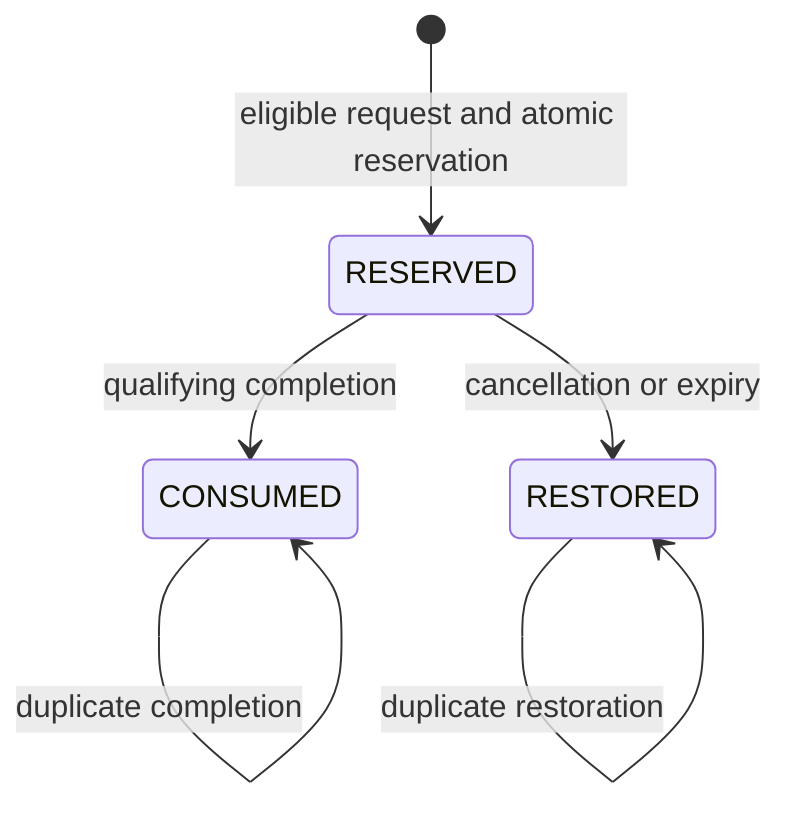

# Encrypted Bilingual Matching Architecture
**Amy V · Full-Stack & AI Systems Engineering**

A sanitized system-design study of EN/ES matching, credit reservations, encrypted messaging boundaries and human-reviewed role activation. The inspected private release record dated 2026-10-02 reports **166 automated tests and 26/26 browser journeys**.

## Design boundaries
- Reserve credits atomically with the matching request; prevent concurrent spending of the same balance.
- Authorize participants before releasing encrypted text. Encryption at rest does not imply end-to-end encryption or participant authorization.
- Keep invitation acceptance separate from administrator approval and professional activation.
- Verify payment-provider signatures over the provider-defined payload, deduplicate event identities, and commit local effects in one transaction.
- Separate interface locale from conversation-language preference.

## Public reference module
`python -m unittest -v`

`module.py` models reservation transitions and terminal-event conflicts. It is a pure function; database transactions, balance arithmetic, provider integration and encryption are intentionally outside it. Read [the verification matrix](docs/e2e-journey-matrix.md) and [publication boundary](docs/publication-boundary.md).
